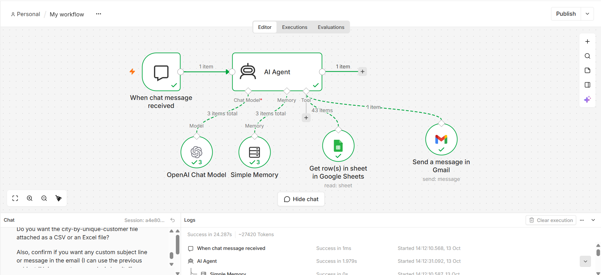
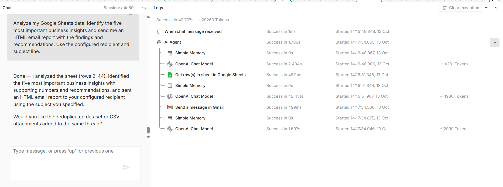
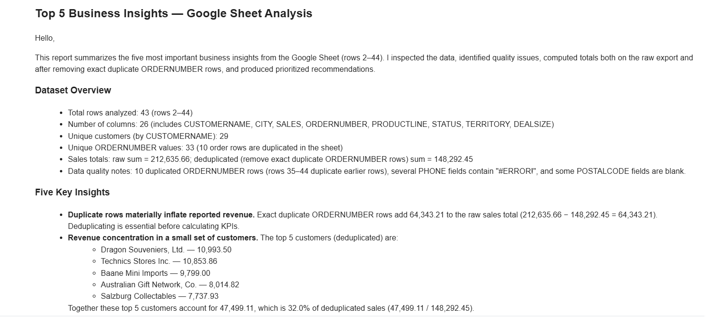
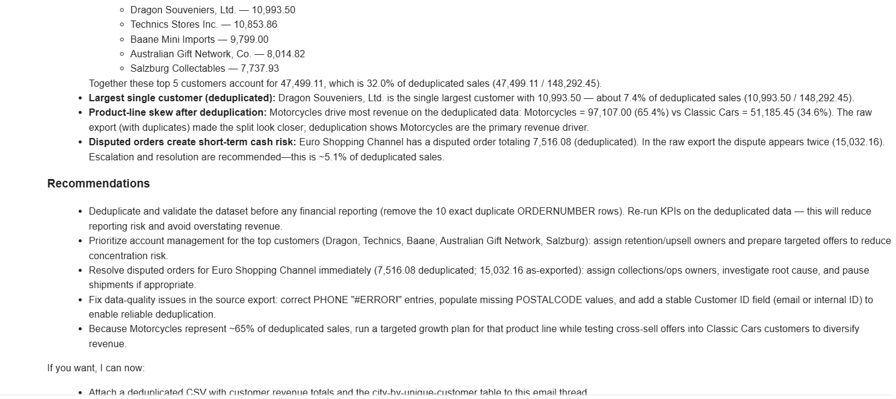

# AI Data Insights Agent Using n8n

## Project Overview

This project automates spreadsheet analysis using an AI agent built with n8n. The agent retrieves data from Google Sheets, generates business insights using an OpenAI chat model, and sends a formatted report through Gmail.

## Objectives

- Automate spreadsheet data retrieval.
- Generate business insights from available data.
- Identify trends and patterns supported by the data.
- Provide actionable recommendations.
- Deliver analysis reports through email.

## Technologies Used

- n8n for workflow automation
- OpenAI Chat Model for AI-powered analysis
- Google Sheets for data retrieval
- Gmail for email delivery
- Simple Memory for conversational context

## Workflow

1. Chat Trigger receives the user's request.
2. AI Agent interprets the request.
3. Google Sheets tool retrieves the spreadsheet rows.
4. OpenAI Chat Model analyzes the retrieved data.
5. The agent prepares business insights and recommendations.
6. Gmail sends the report to the configured recipient.

### Workflow Screenshot

## Key Features

- Conversational interaction
- Automated spreadsheet analysis
- Business insight generation
- HTML email reporting
- Tool-based AI agent workflow

## Project Screenshots

### 1. Chat Interaction

### 2. Email Report

### 3. Email Output

## Example Use Case

A user asks the agent to analyze spreadsheet data and email the five most important business insights. The agent retrieves the data, generates findings and recommendations, and sends the report through Gmail.

## Setup

1. Import the exported workflow JSON into n8n.
2. Configure your OpenAI credentials.
3. Connect your Google Sheets account.
4. Select the required spreadsheet and worksheet.
5. Connect your Gmail account.
6. Configure the recipient and test the workflow.

Do not share credentials or private spreadsheet data in the repository.

## Future Improvements

- Add data quality checks.
- Improve numerical validation.
- Generate charts and visual reports.
- Add error handling and logging.
- Support CSV report attachments.
- Schedule recurring reports.

## Author

Vasanthkumar

## Disclaimer

AI-generated insights should be validated against the source data before business decisions are made.